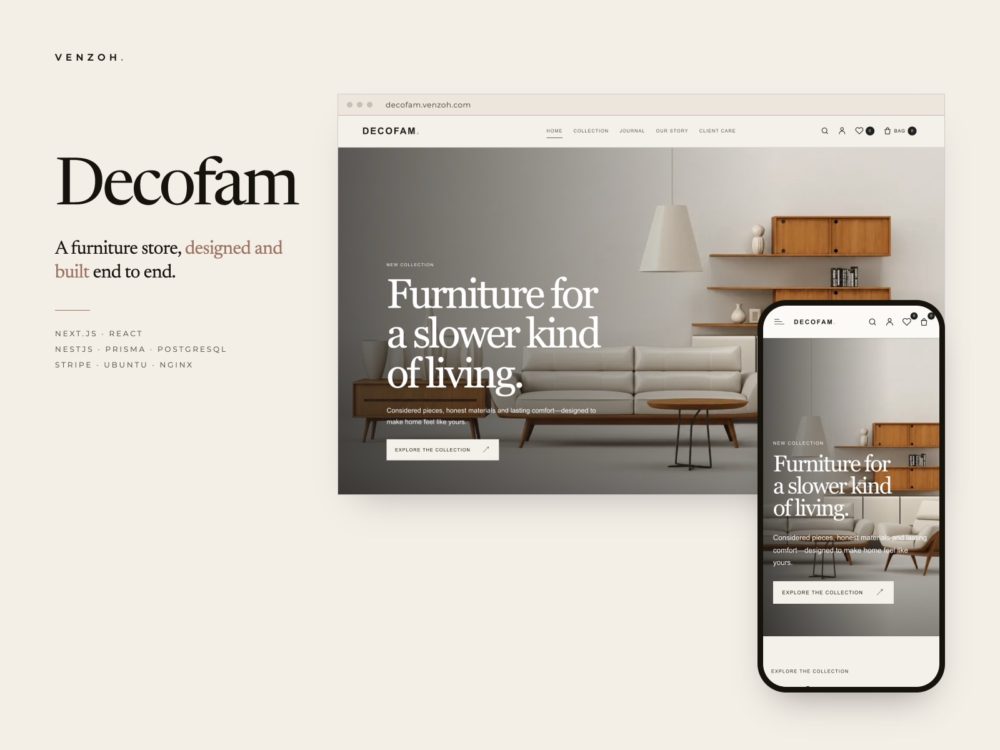
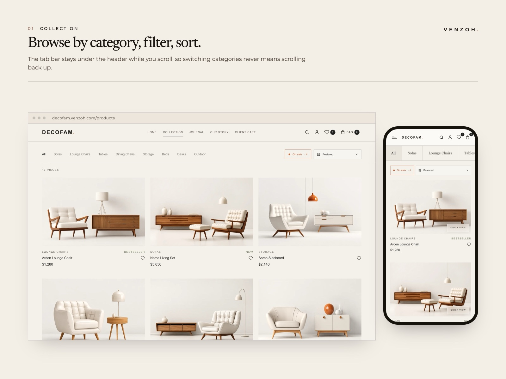
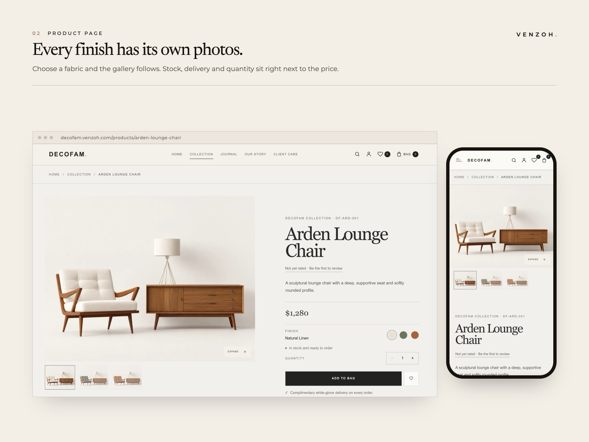
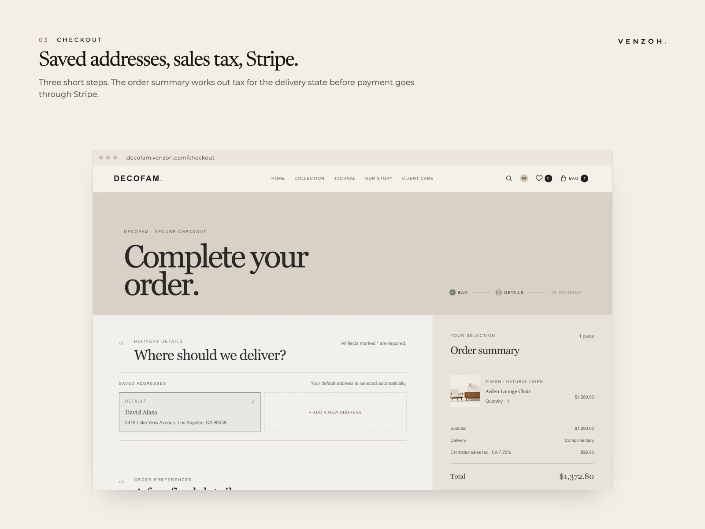
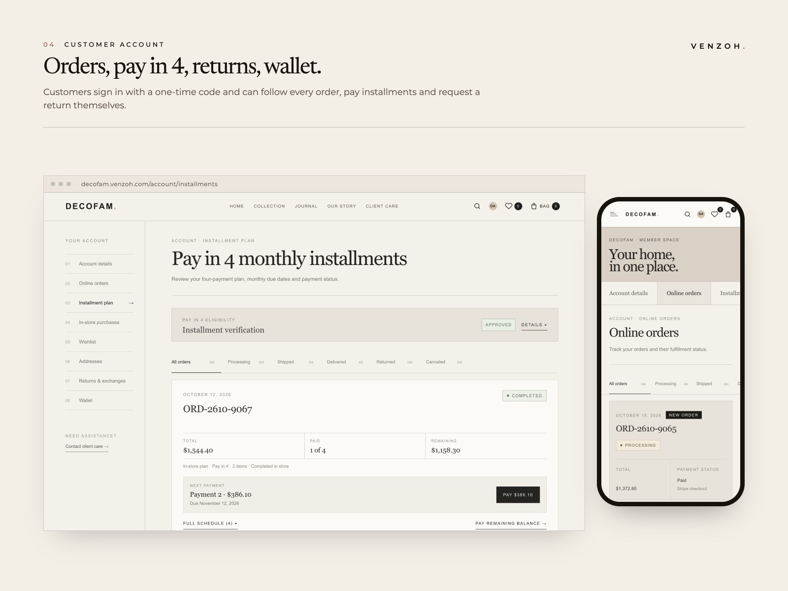
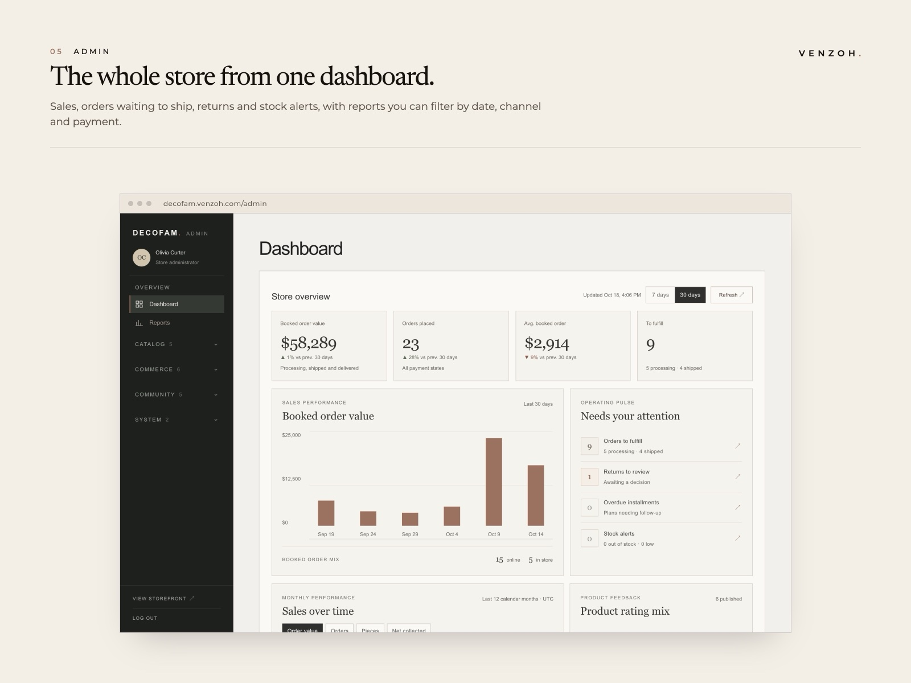
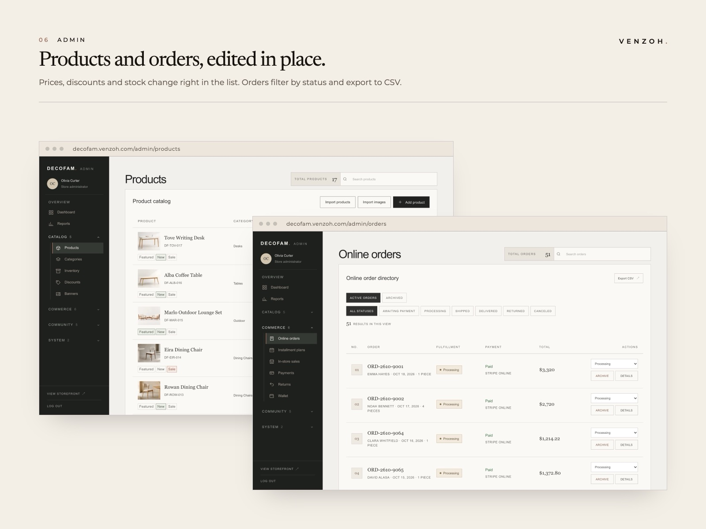
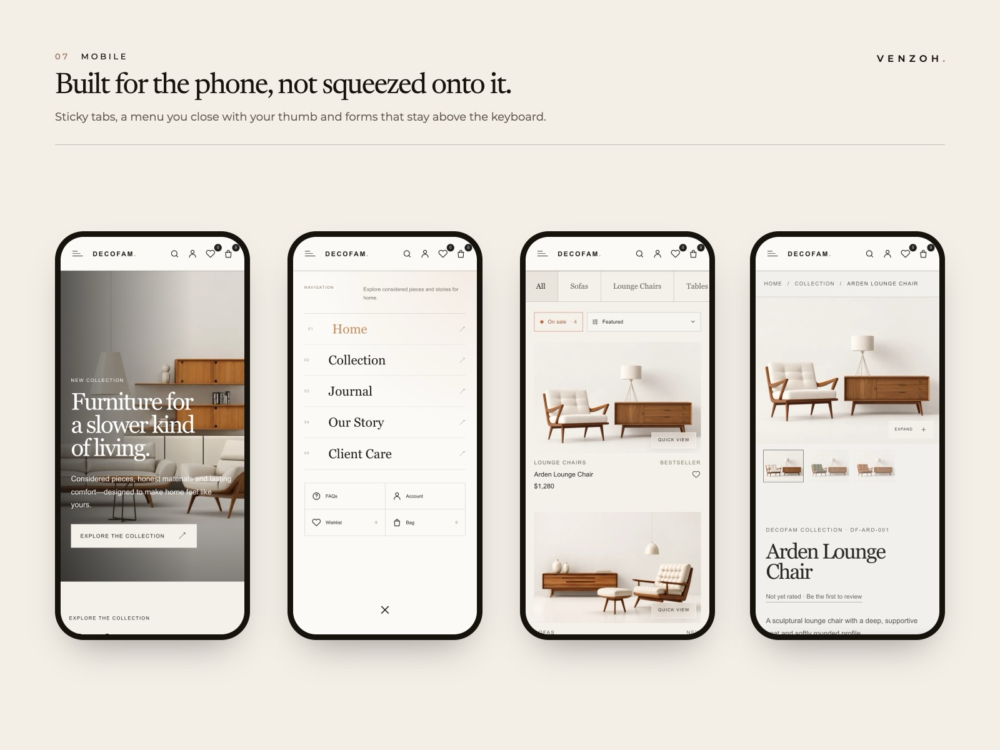
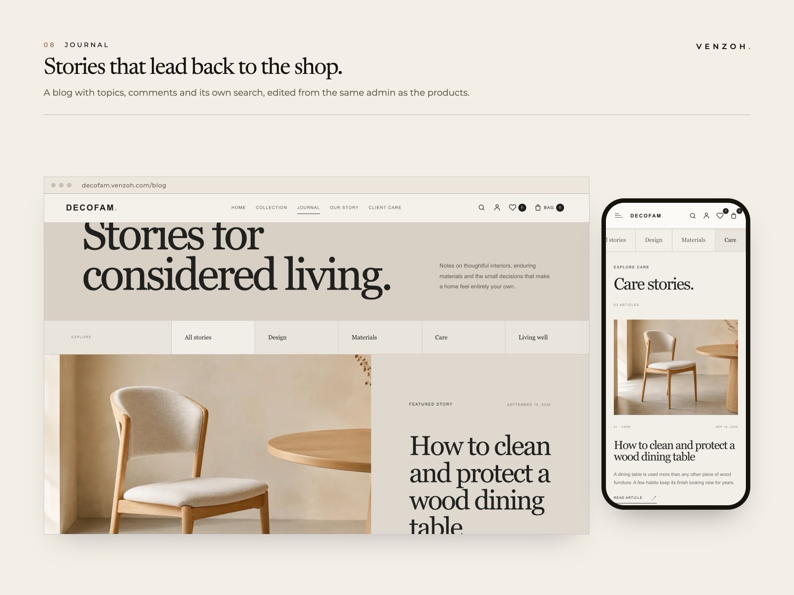

# Decofam

A complete furniture store: a calm, editorial storefront for customers and a full back office for the team that runs it. An order can start on the website, at the shop counter or on an installment plan, and all three share one inventory, one customer list and one set of reports.

Designed and built by [Zohre Tabatabaei](https://github.com/zohre-tabatabaei).

**[Open the live store →](https://decofam.venzoh.com)**

## Try it

Everything on the live store works, the admin panel included.

- **As a customer:** open the account page and choose **Continue as demo**.
- **As the store's team:** open [decofam.venzoh.com/admin](https://decofam.venzoh.com/admin) and choose **Continue as demo admin**.

Each visitor works in a private copy of the data, so you can change anything without affecting anyone else; the copy is cleared after an hour of inactivity. Payments run in Stripe's test mode, and email and text messages are switched off, so nothing real is charged or sent.

## Storefront

- Collection pages with category tabs that stay under the header, an on-sale switch, sorting and search
- Product pages with a gallery and zoom, a finish picker that swaps the photos for the chosen fabric, dimensions, stock status and reviews
- Checkout as a guest or signed in, with sales tax by state and discount codes, paid through Stripe Checkout
- A cancelled or declined payment is retried on the same order, with the details the customer typed still in place
- Pay in four monthly installments after a document review, or with wallet credit
- Journal, FAQs, contact form and wishlist

## Customer account

- Sign-in without a password: an email link, Google or a code by text message (switched off on the live store, where the demo button is used instead)
- Online, installment and in-store orders with their status, wallet and addresses
- Returns and exchanges within the store's return window, counted from delivery; a refund gives back the tax and discount share actually paid, and on an installment order comes off what is still owed first
- A guest's orders move into their account the first time they sign in with the same email

## Admin panel

- Twenty sections: catalog, inventory, discounts, banners, orders, payments, installments, returns, wallet, customers, reviews, messages, the journal, admins and settings
- In-store sales recorded in three steps, on the same stock and customers as the website, taxed by the store's own state
- A whole catalog imported from an Excel or CSV file, with pictures and finishes matched to products by file name
- Prices, discounts and stock edited right in the product list; orders filtered by status and exported to CSV
- Every installment plan shows what is paid, what is outstanding and what is due next
- Stock tracked per warehouse with reservations, so a piece in someone's checkout is not sold twice, and a returned piece goes back on the shelf when it is received
- Every section and filter has its own address

## On a phone

Every page was reworked for the phone rather than shrunk: tab bars that stay in reach, a menu you close with your thumb, forms that stay above the keyboard, and admin panels you close with a swipe. It works from a 320px phone to a wide desktop.

## Journal

Stories grouped by topic, with comments and their own search, written and published from the same admin as the products.

## How it is built

| Area | Technology |
| --- | --- |
| Interface | Next.js (App Router), React, TypeScript |
| API | NestJS, GraphQL (Apollo), TypeScript |
| Data | PostgreSQL with Prisma ORM, Redis |
| Payments | Stripe Checkout with signed webhooks |
| Hosting | Ubuntu server with Nginx, PM2 and Let's Encrypt, behind Cloudflare |
| Quality | More than 350 automated tests, lint and type-check in CI on every change |

A few engineering decisions:

- **Layered feature modules.** Each API module has the same four layers (domain, application, infrastructure, presentation), so business rules are independent of the database and tested on their own.
- **A private store for every demo visitor.** Each visitor who signs in with a demo account gets a private copy of the data, so anything can be tried without touching anyone else's view.
- **Money rules as plain functions.** What a return refunds, how it is split between unpaid installments and the wallet, and when a return window closes are small functions without a database in sight, each with its own tests.
- **Storage that cleans up after itself.** Uploaded files are compared with the database once a day, and pictures nothing uses any more are removed.

## About the code

Decofam is an original concept, not built for a client. The source code is private; if you are evaluating my work and would like to read it, ask and I will give you access.

The Decofam design has not been sold to anyone: the first brand that wants it can have it as its own, exclusively.
